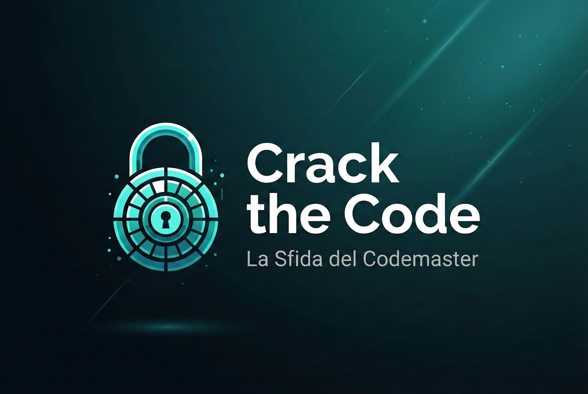

# Crack the Code: La Sfida del Codemaster



**Crack the Code** è un puzzle di deduzione numerica ispirato a **Mastermind**. Hai sette tentativi per ricostruire un codice segreto, interpretando gli indizi del Codemaster. Puoi configurare una partita libera oppure affrontare una campagna di nove livelli.

**Gioca online:** https://falker47.github.io/Crack-the-Code/

## Modalità

### Partita libera

Configura liberamente la sfida:

- lunghezza del codice: **4, 5 o 7 cifre**;
- feedback: **Completo, Sintetico o Criptico**;
- **7 tentativi** per trovare il codice.

Ogni combinazione ha uno scenario narrativo autonomo, senza influire sui progressi della campagna.

### Campagna

La campagna contiene **9 livelli**, uno per ciascuna combinazione tra le tre lunghezze del codice e i tre tipi di feedback.

La storia inizia con piccoli hack tra amici e prosegue verso sistemi sempre più importanti, seguendo un unico filo narrativo. Gli scenari di hacking sono parte della finzione: il gioco non effettua accessi a sistemi reali.

Ogni vittoria sblocca il livello successivo. Il progresso viene salvato nel browser tramite `localStorage`, quando disponibile, e non viene sincronizzato tra dispositivi. Cancellare i dati del sito può azzerarlo.

## Feedback

| Livello | Informazioni ricevute |
| --- | --- |
| **Completo** | Esito cifra per cifra: posizione corretta, presente altrove o assente |
| **Sintetico** | Solo i conteggi complessivi delle tre categorie |
| **Criptico** | Al massimo un'informazione parziale su una cifra, accompagnata da un indizio testuale; in alcuni casi nessuna nuova informazione |

Il **Codemaster** è il personaggio che restituisce il feedback e accompagna la narrazione.

Nella storia viene presentato come una mente digitale, ma il gioco **non utilizza modelli AI, API esterne o servizi backend**. La logica funziona interamente nel browser.

## Regole

- Il codice segreto contiene cifre **tutte diverse**.
- Anche ogni tentativo deve usare cifre diverse.
- Lo **zero può essere la prima cifra** del codice.
- È possibile ripetere un tentativo già effettuato.
- 🟢 = cifra corretta nella posizione corretta.
- 🟡 = cifra presente ma in posizione diversa.
- ⚪ = cifra assente.
- La barra **Appunti** permette di segnare manualmente cifre escluse o confermate.
- Con feedback Completo, le cifre sicuramente assenti vengono escluse automaticamente dagli Appunti.

In caso di vittoria viene assegnato un punteggio che tiene conto della lunghezza del codice, del feedback scelto, dei tentativi rimasti e del tempo impiegato.

## Avvio locale

Il gioco non richiede una build né l'installazione di dipendenze JavaScript. Basta avviare un server HTTP locale, per esempio con Python:

```bash
git clone https://github.com/falker47/Crack-the-Code.git
cd Crack-the-Code
python -m http.server
```

Poi apri `http://localhost:8000` nel browser.

## Verifica

I test utilizzano **Node.js 24**, senza dipendenze npm da installare.

Dalla radice del repository:

```bash
node --check data.js
node --check script.js
node test/validate-data.mjs
node --test
node analysis/verify.mjs
```

Questi controlli verificano la sintassi JavaScript, i dati narrativi, la campagna, le regressioni del gioco, il modello matematico e le evidenze sperimentali.

La CI esegue inoltre uno **smoke test in Chrome reale**, con viewport desktop e mobile, usando Node.js e il browser già installato nel runner.

Per eseguirlo localmente, con Chrome disponibile:

```bash
node tools/browser-smoke.mjs
```

La variabile `CHROME_BIN` permette di specificare l'eseguibile del browser. Se Chrome non è disponibile, lo script segnala un errore anziché considerare il test superato.

## Solver matematico e bilanciamento

Il laboratorio offline in [`analysis/`](analysis/) mantiene separati il motore sperimentale, le osservazioni pubbliche e il solver.

Il solver considera **tutti i codici compatibili** con i feedback ricevuti, ricostruendo anche la memoria degli indizi Criptici. Per scegliere la mossa successiva, però, alcune strategie valutano campioni limitati di tentativi e ipotesi: non si tratta quindi di una strategia ottima dimostrata.

Il laboratorio confronta quattro strategie e lo studio pubblicato comprende **36.000 partite simulate**, distribuite tra le nove configurazioni del gioco.

Le prove matematiche mostrano inoltre che, nel Criptico a 5 o 7 cifre, nessuna strategia può garantire la vittoria entro sette tentativi in tutti i casi possibili. Questo non significa che quelle partite siano impossibili da vincere.

I risultati del solver non sono una misura dell'abilità umana. Il laboratorio non viene caricato dalla pagina web e non aggiunge dipendenze al gioco.

Documentazione:

- [Report comparativo e raccomandazioni](docs/BALANCE_REPORT.md)
- [Modello, limiti e comandi di riproduzione](analysis/README.md)
- [Prove matematiche e informazione del primo turno](docs/MATHEMATICAL_NOTES.md)
- [Risultati grezzi e riepiloghi](analysis/results/)

Per eseguire una simulazione più piccola, con 100 partite per ciascuna delle 36 combinazioni livello/strategia:

```bash
node analysis/simulate.mjs --games 100 --seed esempio --out /tmp/ctc-esempio
```

Usa un prefisso di output nuovo per ogni esecuzione: il simulatore rifiuta di sovrascrivere risultati esistenti.

Il report documenta i risultati e i relativi limiti statistici. Anche quando una strategia non registra sconfitte nel campione, questo non dimostra una garanzia di vittoria.

## Struttura

| Percorso | Contenuto |
| --- | --- |
| `index.html`, `style.css`, `script.js` | Interfaccia e logica del gioco nel browser |
| `data.js` | Campagna, narrativa e catalogo degli indizi |
| `analysis/` | Motore indipendente, solver, simulatori e risultati riproducibili |
| `docs/` | Report di bilanciamento, prove matematiche e documentazione tecnica |
| `test/` | Validazione dati, regressioni del gioco e verifiche del modello |
| `tools/browser-smoke.mjs` | Verifica dei flussi di gioco in Chrome reale |

## Implementazione

- HTML5
- CSS3
- JavaScript vanilla
- `localStorage` per i progressi della campagna
- Distribuzione statica tramite GitHub Pages
- Nessun backend applicativo
- Nessuna dipendenza runtime

## Licenza

Il repository non contiene attualmente un file `LICENSE` né una licenza esplicita per il riutilizzo del codice. Per informazioni sulle condizioni di utilizzo, contatta l'autore.

## Autore

**Maurizio Falconi** — [falker47](https://github.com/falker47)

[Portfolio](https://falker47.github.io/)
