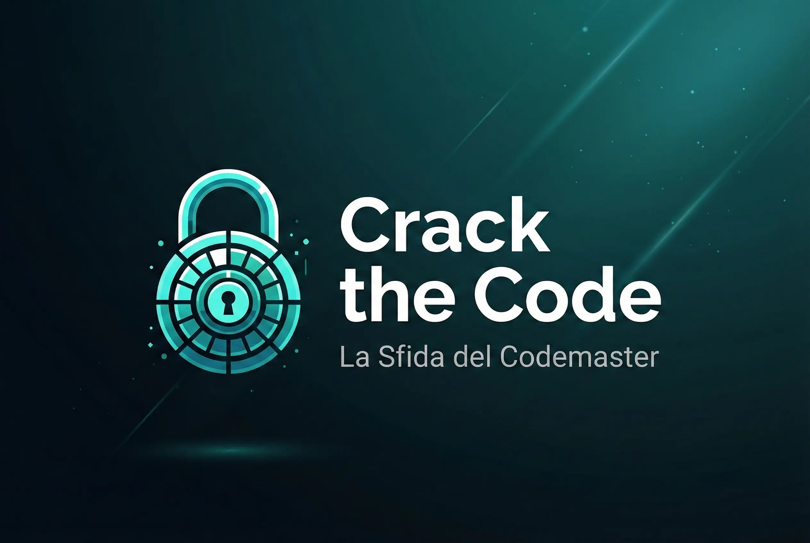

# Crack the Code: La Sfida del Codemaster



**Crack the Code** è un puzzle di deduzione numerica ispirato a **Mastermind**. Hai sette tentativi per ricostruire un codice composto da cifre uniche, usando indizi progressivamente meno espliciti.

**Live demo:** https://falker47.github.io/Crack-the-Code/

## Modalità

### Partita libera

Configura liberamente la sfida:

- lunghezza del codice: **4, 5 o 7 cifre**;
- feedback: **Completo, Sintetico o Criptico**;
- **7 tentativi** per trovare il codice.

Ogni combinazione usa uno scenario narrativo standalone.

### Campagna

La campagna contiene **9 livelli**, cioè tutte le combinazioni tra le tre lunghezze e i tre livelli di feedback.

La progressione parte da piccoli hack tra amici e cresce fino a sistemi sempre più importanti, collegati da un unico filo narrativo. I livelli si sbloccano in sequenza e il progresso viene salvato localmente nel browser tramite `localStorage`.

## Feedback

| Livello | Informazioni ricevute |
| --- | --- |
| **Completo** | Esito cifra per cifra: posizione corretta, presente altrove o assente |
| **Sintetico** | Solo i conteggi complessivi delle tre categorie |
| **Criptico** | Al massimo un'informazione parziale su una cifra rilevata, accompagnata da un indizio |

Il **Codemaster** è il personaggio/interfaccia narrativa che restituisce il feedback.

Nella fiction viene presentato come una mente digitale; il gioco, però, **non utilizza modelli AI, API esterne o servizi backend**. Tutta la logica gira localmente nel browser.

## Regole

- il codice segreto usa cifre **tutte diverse**;
- anche ogni tentativo deve usare cifre diverse;
- 🟢 = cifra corretta nella posizione corretta;
- 🟡 = cifra presente ma in posizione diversa;
- ⚪ = cifra assente;
- la barra **Appunti** permette di segnare manualmente cifre escluse o confermate;
- con feedback Completo, le cifre sicuramente assenti vengono escluse automaticamente dagli Appunti.

## Avvio locale

Non ci sono dipendenze runtime o build step.

```bash
git clone https://github.com/falker47/Crack-the-Code.git
cd Crack-the-Code
python -m http.server
```

Poi apri `http://localhost:8000`.

## Verifica

La CI controlla sintassi, dati narrativi e campagna, modello matematico ed evidenze sperimentali:

```bash
node --check data.js
node --check script.js
node test/validate-data.mjs
node --test
node analysis/verify.mjs
```

La CI esegue anche uno smoke test in Chrome reale (desktop e viewport mobile)
usando soltanto Node.js e il browser già presente nel runner. In locale, se
Chrome è disponibile, eseguire `node tools/browser-smoke.mjs`; `CHROME_BIN`
permette di specificarne l'eseguibile. Un browser mancante produce un errore,
non un test saltato silenziosamente.

## Solver matematico e bilanciamento

Il laboratorio offline in [`analysis/`](analysis/) mantiene separati motore,
osservazioni pubbliche e solver. Esamina esattamente tutti i codici compatibili,
compreso lo stato degli indizi criptici. La selezione della mossa è limitata da
campioni espliciti: non è una strategia ottima dimostrata né una misura di abilità
umana. Non viene caricato dalla pagina web e non aggiunge dipendenze al gioco.

- [Report comparativo e raccomandazioni](docs/BALANCE_REPORT.md)
- [Modello, limiti e comandi di riproduzione](analysis/README.md)
- [Prove matematiche e informazione del primo turno](docs/MATHEMATICAL_NOTES.md)
- [Risultati grezzi e riepiloghi](analysis/results/)

Esempio rapido (100 partite per ciascuna delle 36 combinazioni livello/strategia):

```bash
node analysis/simulate.mjs --games 100 --seed esempio --out /tmp/ctc-esempio
```

Scegliere un prefisso nuovo per ogni esecuzione: il simulatore rifiuta di
sovrascrivere risultati esistenti. Per i risultati pubblicati e i relativi limiti
statistici vedere il report; zero sconfitte osservate non prova una garanzia.

## Struttura

| Percorso | Contenuto |
| --- | --- |
| `index.html`, `style.css`, `script.js` | Interfaccia e motore del gioco nel browser |
| `data.js` | Campagna, narrativa e catalogo degli indizi |
| `analysis/` | Motore indipendente, solver, simulatori e risultati riproducibili |
| `docs/` | Report di bilanciamento, prove matematiche e specifica tecnica |
| `test/` | Validazione dati, regressioni del gioco e oracoli del modello |
| `tools/browser-smoke.mjs` | Verifica dei flussi del gioco in Chrome reale |

## Implementazione

- HTML5
- CSS3
- JavaScript Vanilla
- `localStorage` per il progresso della campagna
- nessun backend
- nessuna dipendenza runtime

## Autore

**Maurizio Falconi** — [falker47](https://github.com/falker47)

[Portfolio](https://falker47.github.io/Nexus-portfolio/)
